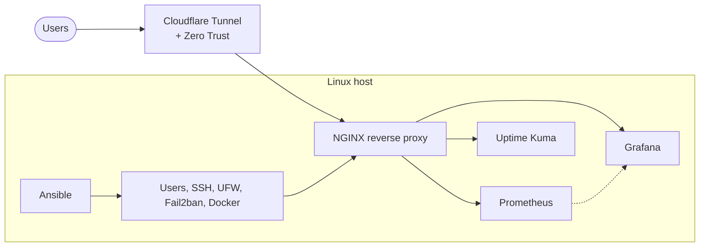

<div align="center">
<pre>
     .-~*~-.
 +-------------+
 |   o  w  o   |   homelab
 | [=========] |   self-hosted, as code
 | [=========] |
 +--+-------+--+
 *  '       '  *
</pre>
</div>

<h1 align="center">homelab-template</h1>

<p align="center">
self-hosted linux, managed as code · no secrets, no open ports
</p>

<p align="center">


</p>

<p align="center">
.·:*¨¨* ❀ *¨¨*:·.
</p>

Sanitized template of a self-hosted Linux homelab managed as code.

This repository shows how the lab is built and operated: Ansible provisions the host, Docker Compose runs the services, NGINX sits in front as a reverse proxy, and Cloudflare Tunnel / Zero Trust is the only path in. There are no open inbound ports.

It does **not** contain a live lab. Hostnames, addresses, and secrets here are placeholders (`example.com`, `192.168.1.x`). Copy the `.example` files, replace the values, and keep real data out of git.

<p align="center">
.·:*¨¨* ❀ *¨¨*:·.
</p>

#### architecture



Access is outbound-only: `cloudflared` establishes a tunnel to Cloudflare. NGINX never binds a public port. Grafana, Prometheus, and Uptime Kuma are reachable only through the proxy (and only after Zero Trust policy allows the request).

<p align="center">
.·:*¨¨* ❀ *¨¨*:·.
</p>

#### stack

- **Ansible** — host provisioning
- **Docker Compose** — containerized services (Podman-compatible)
- **NGINX** — reverse proxy with security headers
- **Cloudflare Zero Trust** — remote access with no open inbound ports
- **Prometheus + Grafana** — metrics and dashboards
- **Uptime Kuma** — endpoint monitoring
- **Fail2ban** — SSH brute-force protection
- **UFW** — host firewall (allow SSH only; firewalld can be swapped in)

<p align="center">
.·:*¨¨* ❀ *¨¨*:·.
</p>

#### repository layout

```
ansible/
  ansible.cfg
  inventory.example.ini      # copy to inventory.ini
  group_vars/all.example.yml # copy to group_vars/all.yml
  requirements.yml
  site.yml
  roles/
    common/                  # packages, timezone, unattended upgrades
    users_ssh/               # admin user, key-only SSH
    firewall/                # UFW, SSH only
    fail2ban/                # sshd jail
    docker/                  # Docker Engine + Compose plugin
compose/
  docker-compose.yml
  .env.example               # copy to .env
  nginx/conf.d/example.conf
  prometheus/prometheus.yml
```

<p align="center">
.·:*¨¨* ❀ *¨¨*:·.
</p>

#### quick start

The playbook targets Debian or Ubuntu. You need Ansible on your workstation, SSH access to the host, and Docker Compose (or Podman) on the host after the playbook runs.

```bash
ansible-galaxy collection install -r ansible/requirements.yml
```

1. **Copy the example files and edit the placeholders.**

   ```bash
   cp ansible/inventory.example.ini ansible/inventory.ini
   cp ansible/group_vars/all.example.yml ansible/group_vars/all.yml
   cp compose/.env.example compose/.env
   ```

   In `inventory.ini` and `group_vars/all.yml`, set the host address, the admin user, and **your** SSH public key. In `compose/.env`, set a strong Grafana password and your Cloudflare Tunnel token.

2. **Keep secrets out of plaintext files.** Encrypt anything sensitive with Ansible Vault:

   ```bash
   # Edit an encrypted file (created on first save if it does not exist)
   ansible-vault create ansible/group_vars/vault.yml
   ansible-vault edit ansible/group_vars/vault.yml

   # Or encrypt a single value and paste it into group_vars
   ansible-vault encrypt_string 'your-secret' --name vault_grafana_admin_password
   ```

   `ansible/group_vars/all.yml` and `ansible/group_vars/vault.yml` are gitignored. Pass the vault password when you run the playbook with `--ask-vault-pass` or `--vault-password-file` (that file must never be committed).

3. **Provision the host.**

   ```bash
   cd ansible
   ansible-playbook --ask-become-pass -i inventory.ini site.yml
   ```

   Install your real public key before the playbook disables password authentication, and keep an active session open until you have confirmed key-based login.

4. **Start the services.**

   ```bash
   cd compose
   docker compose up -d
   # or: podman compose up -d
   ```

   Point the Cloudflare Tunnel at the NGINX container (`http://nginx:80`) and add public hostnames such as `grafana.example.com`. No inbound firewall rules are required.

<p align="center">
.·:*¨¨* ❀ *¨¨*:·.
</p>

#### security

- **Secrets stay out of git.** `.env`, `inventory.ini`, `group_vars/all.yml`, `group_vars/vault.yml`, `*.vault`, `*.key`, and `*.pem` are gitignored. Only `.example` files are tracked.
- **Ansible Vault** encrypts credentials at rest in the repo, if you choose to store them there at all.
- **SSH is key-only.** Password authentication and root login are disabled after the admin user's authorized keys are installed.
- **Least privilege.** The host firewall allows SSH only. Application ports are not published on the host; they listen on an internal compose network. Remote access goes through Cloudflare Zero Trust, not a public bind.
- **Fail2ban** watches `sshd` and bans repeated failures.

The example SSH key and `192.168.1.10` address are placeholders. The playbook refuses to disable password login if `admin_ssh_keys` is still the example value, so you cannot lock yourself out by running it unchanged.

<p align="center">
.·:*¨¨* ❀ *¨¨*:·.
</p>

#### roadmap

- [ ] Automated backups (for example, restic) of Docker volumes
- [ ] Local LLM with Ollama, reachable only on the internal network
- [x] CI lint (`yamllint` + `ansible-lint`)

<p align="center">
.·:*¨¨* ❀ *¨¨*:·.
</p>

#### license

MIT © Ana Beatriz

<p align="center">
.·:*¨¨* ❀ *¨¨*:·.
</p>
